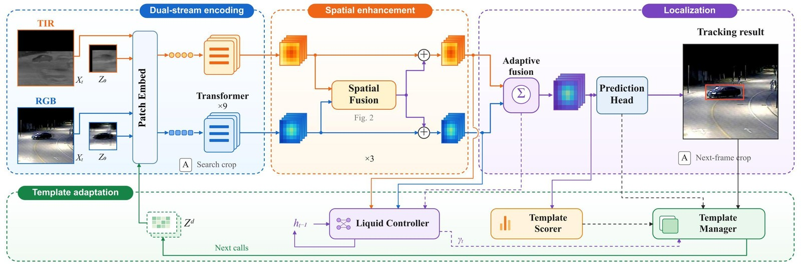
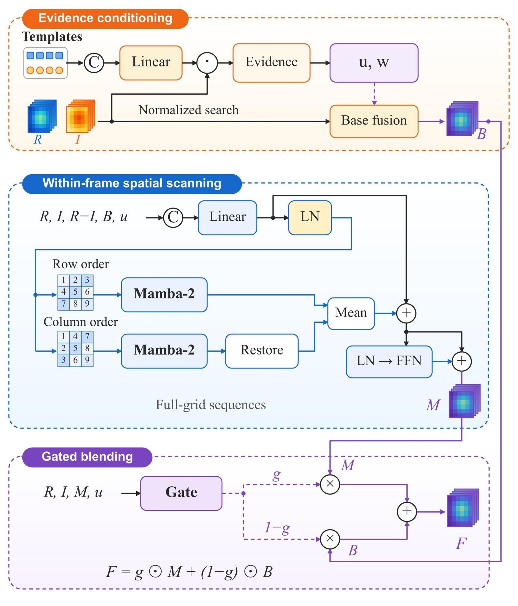
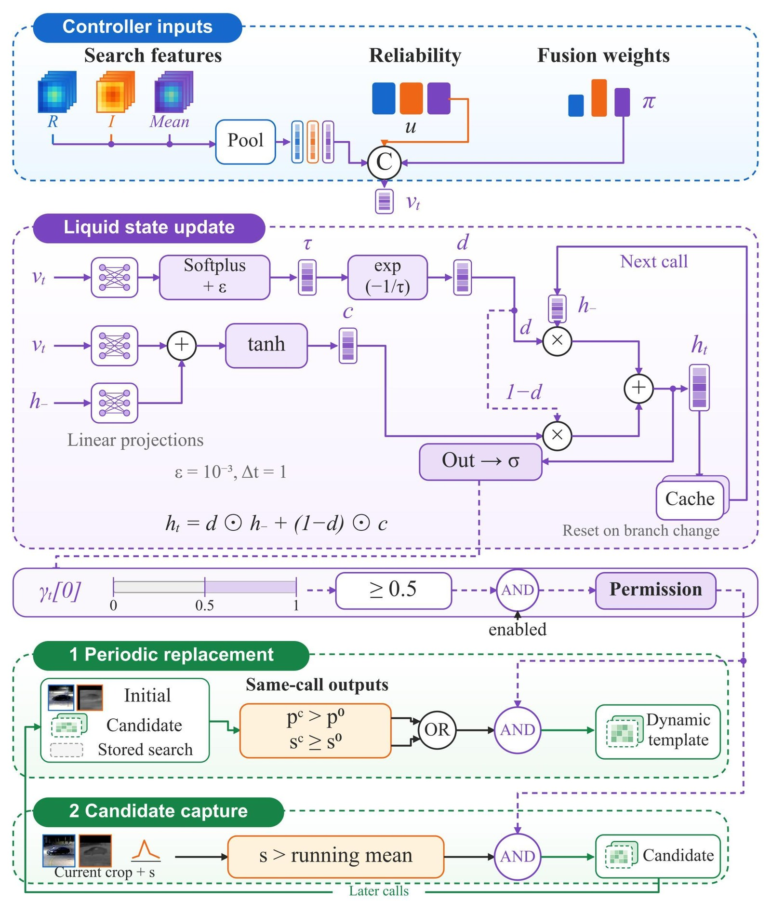

# SGTA-Track: State-Gated Template Adaptation for RGB–Thermal Tracking

> **Status: the manuscript is under review.**
> Model code, configurations, the main benchmark results, the trained weights and
> the per-sequence predictions are public (see
> [Pretrained Weights and Downloads](#pretrained-weights-and-downloads)).
> Publication details and the final citation will be added after the review
> process.

SGTA-Track is an RGB–thermal (visible–thermal, RGB-T) single-object tracking framework built on a dual-stream ViT-B/16 CE-Adapter backbone. Its central idea is that *choosing among candidate templates* and *being allowed to update the template* are two different decisions: a single response score can rank candidates, but ranking alone does not establish whether any of them should be adopted. SGTA-Track therefore produces a **relative template preference** and a separate **update permission**, and uses the latter to regulate both candidate capture and periodic template replacement.

This repository provides the training pipeline, testing/evaluation entry points, the cumulative ablation configurations of the manuscript, the trained checkpoints, the per-sequence predictions on five benchmarks, and the analysis tools used for the reported numbers. It supports LasHeR, VTUAV (short-term and long-term protocols), RGBT234, RGBT210, and GTOT.

## Quick Start

```bash
# 1) build the network and check the Mamba-2 kernels
python tools/check_sgta_setup.py --config lasher_train

# 2) train on LasHeR (single GPU)
python -u tracking/train.py --script bat --config lasher_train \
    --save_dir ./output --mode single

# 3) evaluate one checkpoint
python RGBT_workspace/test_sgta.py --yaml_name lasher_train --epoch 30 \
    --checkpoint output/checkpoints/train/bat/lasher_train/BATrack_ep0030.pth.tar \
    --dataset lasher --workers 4
```

Dataset roots are supplied through environment variables (see [Path Configuration](#path-configuration)); no absolute path of the authors' machine needs to be edited.

## Core Modules

- **M — Pre-head Modality Mixing** (`MoEWhenToFuseDecision`): combines the RGB, thermal, and averaged token streams with an uncertainty-conditioned gate before the box head, instead of a fixed `0.5·(f_rgb + f_tir)` average.
- **S — Evidence-conditioned Spatial Enhancement** (`UncertaintyGuidedMambaFusion`): template–search correlation cues condition row-major and column-major Mamba-2 scans inside the last three backbone blocks.
- **R — Paired Scoring and Dynamic Templates** (`TemplateRouter`): scores the two candidate templates relative to each other and maintains the dynamic template from those scores.
- **L — State-dependent Permission** (`LiquidTemplateUpdateController`): an input-dependent decay controller with a recurrent hidden state that turns current multimodal features and retained history into an update permission, filtering which candidates may be captured and when the template is replaced.

All four modules live in [`lib/models/bat/sgta_modules.py`](lib/models/bat/sgta_modules.py) and are wired in [`lib/models/bat/vit_ce_adapter.py`](lib/models/bat/vit_ce_adapter.py). The explicit temporal-prediction branch of the earlier prototype is not part of the method and stays disabled in every released configuration (`USE_TEMPORAL_MAMBA: False`, `USE_LEGACY_TEMPORAL_PREDICTOR: False`).

## Method Framework

### Overall architecture

Dual-stream ViT-B/16 encoding, reliability-conditioned spatial enhancement in the last three encoder blocks, adaptive modality mixing before the prediction head, and state-gated template adaptation across calls.



### Evidence-conditioned spatial enhancement (S)

Template–search correlations produce reliability proxies and fusion weights; full-grid sequences are scanned in row-major and column-major order by Mamba-2 and blended back with a local gate.



### State-gated template adaptation (R and L)

The controller pools current search evidence, reliability, and fusion weights, updates its liquid state with an input-dependent decay, and converts the resulting permission into two gated operations: periodic template replacement and candidate capture.



## Repository Structure

```text
SGTA-Track/
|-- assets/figures/             # figures used in this README
|-- experiments/bat/            # the released experiment configurations
|   |-- lasher_train.yaml       # LasHeR, full model
|   |-- lasher_ablation_a0.yaml # cumulative ablation, rung A0 (baseline)
|   |-- lasher_ablation_a1.yaml # rung A1
|   |-- lasher_ablation_a2.yaml # rung A2
|   |-- lasher_ablation_a3.yaml # rung A3
|   `-- vtuav_train.yaml        # VTUAV, full model
|-- lib/
|   |-- config/bat/config.py    # all defaults, plus the environment overrides
|   |-- models/bat/             # ViT-B/16 CE-Adapter backbone and BATrack head
|   |   |-- sgta_modules.py     # M / S / R / L modules
|   |   `-- vit_ce_adapter.py   # where the modules are wired in
|   |-- train/                  # datasets, actor, trainer, training pipeline
|   `-- test/                   # tracker and parameter loading
|-- RGBT_workspace/test_sgta.py # standalone tracking + evaluation entry point
|-- tools/                      # setup check, diagnostics, official-toolkit evaluation
|-- tracking/train.py           # training entry point
|-- requirements.txt            # Python dependencies other than PyTorch
`-- .gitignore
```

## Environment Setup

The reference environment is Python 3.9, PyTorch 2.3.1 + CUDA 12.1, and a single NVIDIA GPU (48 GB for the LasHeR recipe with batch 12; a 24 GB card is sufficient for VTUAV with batch 4). The Mamba-2 kernels are compiled against a specific CUDA version, so keeping this combination is recommended.

```bash
conda create -n sgta python=3.9 -y
conda activate sgta

# PyTorch matching your driver (example: CUDA 12.1)
pip install torch==2.3.1 torchvision==0.18.1 --index-url https://download.pytorch.org/whl/cu121

# Remaining dependencies
pip install -r requirements.txt

# Mamba-2 kernels: require nvcc (CUDA_HOME) and the SAME CUDA version as torch
pip install causal-conv1d==1.4.0
pip install mamba-ssm==2.2.4
```

Check the installation before training (builds the network, counts parameters, imports Mamba):

```bash
python tools/check_sgta_setup.py --config lasher_train
```

Expected parameter counts, which also indicate whether the requested modules were built:

| Configuration | Parameters | Mamba-2 blocks |
| --- | ---: | ---: |
| `lasher_ablation_a0` | 92,518,533 | 0 |
| `lasher_train` | 140,290,201 | 6 |

### Path Configuration

Dataset and output roots are read from environment variables, so a clone runs without editing source paths. Set them before running from the repository root:

```bash
export RGBT_DATA_ROOT=/path/to/RGBTData        # common parent of all datasets
export LASHER_TRAIN_HOME=$RGBT_DATA_ROOT/LasHeR/train
export LASHER_TEST_ROOT=$RGBT_DATA_ROOT/LasHeR/test
export VTUAV_HOME=$RGBT_DATA_ROOT/VTUAV
```

| Variable | Default | Used by |
| --- | --- | --- |
| `RGBT_DATA_ROOT` | `/root/RGBTData` | every dataset root below |
| `LASHER_TRAIN_HOME` | `$RGBT_DATA_ROOT/LasHeR/train` | training (`LasHeR_train`, `LasHeR_val`) |
| `LASHER_TEST_ROOT` / `LASHER_HOME` | `$RGBT_DATA_ROOT/LasHeR/test` | `--dataset lasher` |
| `VTUAV_HOME` | `$RGBT_DATA_ROOT/VTUAV` | VTUAV training and evaluation |
| `GTOT_ROOT` | `$RGBT_DATA_ROOT/GTOT` | `--dataset gtot` |
| `RGBT210_ROOT` | `$RGBT_DATA_ROOT/RGBT210` | `--dataset rgbt210` |
| `RGBT234_ROOT` | `$RGBT_DATA_ROOT/RGBT234` | `--dataset rgbt234` |

## Data Preparation

Training uses the LasHeR training set; the expected layout is:

```text
$RGBT_DATA_ROOT/LasHeR/
|-- train/
|   `-- <sequence>/
|       |-- visible/         # RGB frames
|       |-- infrared/        # thermal frames
|       |-- visible.txt      # annotations
|       `-- infrared.txt
`-- test/
    `-- <sequence>/
        |-- visible/
        |-- infrared/
        `-- visible.txt
```

VTUAV expects the original release layout:

```text
$VTUAV_HOME/
|-- train/<sequence>/{rgb,ir}/  + rgb.txt, ir.txt, init.txt
|-- test_ST/<sequence>/{rgb,ir}/
`-- test_LT/<sequence>/{rgb,ir}/
```

The evaluation entry point also supports the remaining benchmarks:

| Argument | Image directories | Annotation files |
| --- | --- | --- |
| `--dataset lasher` | `visible/`, `infrared/` | `visible.txt` |
| `--dataset lasher_val` | `visible/`, `infrared/` | `visible.txt` (LasHeR train split used as validation) |
| `--dataset gtot` | `v/`, `i/` | `groundTruth_v.txt`, `groundTruth_i.txt` (converted from `x1,y1,x2,y2`) |
| `--dataset rgbt210` | `visible/`, `infrared/` | `init.txt` |
| `--dataset rgbt234` | `visible/`, `infrared/` | `visible.txt`, `infrared.txt` |
| `--dataset vtuav_st` / `vtuav_lt` | `rgb/`, `ir/` | `rgb.txt` |

Thermal frames are converted to three channels and concatenated with the RGB frames into a six-channel input by the evaluation entry point.

### Dataset and Evaluation Resources

Dataset downloads and usage must follow the license agreements of their publishers; the table only links the official pages and toolkits.

| Resource | Dataset page | Official evaluation toolkit |
| --- | --- | --- |
| [GTOT](https://chenglongli.cn/_code-dataset/dataset) | [Official resource page](https://chenglongli.cn/_code-dataset/dataset) | [Official repository](https://github.com/mmic-lcl/Datasets-and-benchmark-code) |
| [RGBT210](https://chenglongli.cn/_code-dataset/dataset) | [Official resource page](https://chenglongli.cn/_code-dataset/dataset) | [Official repository](https://github.com/mmic-lcl/Datasets-and-benchmark-code) |
| [RGBT234](https://chenglongli.cn/_code-dataset/dataset) | [Official resource page](https://chenglongli.cn/_code-dataset/dataset) | [Official repository](https://github.com/mmic-lcl/Datasets-and-benchmark-code) |
| [LasHeR](https://github.com/BUGPLEASEOUT/LasHeR) | [Official repository](https://github.com/BUGPLEASEOUT/LasHeR#dataset) | [Official toolkit](https://pan.baidu.com/s/1LRIceZ62x5CHobpyZcGxEQ), code `mmic` |
| [VTUAV](https://zhang-pengyu.github.io/DUT-VTUAV/) | [Official project page](https://zhang-pengyu.github.io/DUT-VTUAV/) | [Official toolkit](https://drive.google.com/file/d/1B3609O1TUC9WIfNqevKK-OOlGGiJ11m0/view?usp=sharing) |

## Experiment Configurations

Configurations are located under `experiments/bat/`; pass the file name without the `.yaml` suffix.

| Configuration | Description |
| --- | --- |
| `lasher_train` | LasHeR, full model: M, S, R, L enabled. |
| `lasher_ablation_a0` | Ablation rung A0: fixed averaging, static templates, no SGTA module. |
| `lasher_ablation_a1` | Rung A1: A0 + M (pre-head modality mixing). |
| `lasher_ablation_a2` | Rung A2: A1 + S (evidence-conditioned spatial enhancement). |
| `lasher_ablation_a3` | Rung A3: A2 + R (paired scoring and dynamic templates). |
| `vtuav_train` | VTUAV, full model. |

All configurations share a 128×128 template, a 256×256 search region, a ViT-B/16 backbone, and AdamW. The initialization weights are specified by `MODEL.PRETRAIN_FILE`. Before training, download `DropTrack_k700_800E_alldata.pth.tar` from [Pretrained Weights and Downloads](#pretrained-weights-and-downloads) and place it in the repository root, or point `MODEL.PRETRAIN_FILE` to your copy. It is not needed when evaluating an already trained checkpoint.

## Training

Single GPU (run from the repository root):

```bash
# LasHeR, full model
python -u tracking/train.py --script bat --config lasher_train \
    --save_dir ./output --mode single

# VTUAV
python -u tracking/train.py --script bat --config vtuav_train \
    --save_dir ./output --mode single
```

Multiple GPUs (DDP):

```bash
python -u tracking/train.py --script bat --config lasher_train \
    --save_dir ./output --mode multiple --nproc_per_node 4
```

What the runs do:

- **LasHeR** (`lasher_train`): 30 epochs, batch 12, AdamW, LR 1e-4 dropped to 1e-5 at epoch 20, one checkpoint per epoch. After every epoch a complete LasHeR evaluation runs in-process and prints both protocols (`[LASHER_RESULT]` internal, `[LASHER_OFFICIAL]` official PR/NPR/SR).
- **VTUAV** (`vtuav_train`): 30 epochs, batch 4, 20,000 samples per epoch (5,000 iterations), LR 1e-5 dropped at epoch 20. Checkpoints only — a full VTUAV sweep after every epoch is expensive, so evaluate afterwards.

Checkpoints and logs:

```text
output/checkpoints/train/bat/<config_name>/BATrack_epXXXX.pth.tar
output/logs/bat-<config_name>.log
```

Resuming is automatic: `TRAIN.LOAD_LATEST` is enabled, so re-running the same command continues from the newest checkpoint in the same `--save_dir`. Set `LOAD_LATEST=0` to start from scratch. Crashed runs are retried `TRAIN_RETRIES` times (default 3), resuming from the last checkpoint.

### Changing Hyper-parameters Without Editing the YAML

A small set of environment variables overrides the configuration at start-up (effective values are printed as `[CONFIG] env overrides: ...`):

```bash
BATCH_SIZE=6 NUM_WORKER=4 AMP=1 python -u tracking/train.py --script bat \
    --config lasher_train --save_dir ./output --mode single
```

| Variable | Configuration key |
| --- | --- |
| `BATCH_SIZE` | `TRAIN.BATCH_SIZE` |
| `NUM_WORKER` | `TRAIN.NUM_WORKER` |
| `EPOCH` | `TRAIN.EPOCH` |
| `LR` | `TRAIN.LR` |
| `AMP` | `TRAIN.AMP` |
| `TRAIN_SAMPLE_PER_EPOCH` | `DATA.TRAIN.SAMPLE_PER_EPOCH` |
| `VAL_SAMPLE_PER_EPOCH` | `DATA.VAL.SAMPLE_PER_EPOCH` |
| `EVAL_LASHER_EVERY_EPOCH` | `TRAIN.EVAL_LASHER_EVERY_EPOCH` |
| `EVAL_LASHER_EPOCH_INTERVAL` | `TRAIN.EVAL_LASHER_EPOCH_INTERVAL` |
| `EVAL_DATASET` | `TRAIN.EVAL_DATASET` |
| `EVAL_LASHER_SAVE_DIR` | `TRAIN.EVAL_LASHER_SAVE_DIR` |
| `EVAL_LASHER_RESULTS_NS` | `TRAIN.EVAL_LASHER_RESULTS_NS` |
| `LOAD_LATEST` | `TRAIN.LOAD_LATEST` |
| `TRAIN_RETRIES` | number of retries after a crash |

The per-epoch evaluation hook has two extra knobs that are not configuration keys:

* `EVAL_LASHER_SEQUENCE=<sequence>` restricts the hook to one sequence, which
  smoke-tests the whole save → park → evaluate → history chain in about a minute
  instead of hours.
* `EVAL_OFFICIAL_TOOLKIT` (default on) and `EVAL_OFFICIAL_TOOLKIT_EVERY`
  (default 5) control the periodic cross-check of the in-process official metrics
  against the `rgbt` package. It is skipped automatically for a single-sequence
  dump, because the toolkit needs every sequence of the dataset.

## Testing and Evaluation

`RGBT_workspace/test_sgta.py` tracks one checkpoint and reports the metrics. The default checkpoint path is
`output/checkpoints/train/bat/<yaml_name>/BATrack_ep<epoch>.pth.tar`; pass `--checkpoint` to evaluate a file anywhere.

```bash
# LasHeR test split
python RGBT_workspace/test_sgta.py --yaml_name lasher_train --epoch 30 \
    --dataset lasher --workers 4

# explicit checkpoint file
python RGBT_workspace/test_sgta.py --yaml_name lasher_train --epoch 30 \
    --checkpoint output/checkpoints/train/bat/lasher_train/BATrack_ep0030.pth.tar \
    --dataset lasher --workers 4

# VTUAV short-term / long-term
python RGBT_workspace/test_sgta.py --yaml_name vtuav_train --epoch 30 --dataset vtuav_st --workers 4
python RGBT_workspace/test_sgta.py --yaml_name vtuav_train --epoch 30 --dataset vtuav_lt --workers 4

# the whole RGBT table with one checkpoint
for d in lasher gtot rgbt210 rgbt234; do
  python RGBT_workspace/test_sgta.py --yaml_name lasher_train --epoch 30 --dataset $d --workers 4
done
```

Each worker loads a full model copy, so raise `--workers` according to CPU memory; validate with one worker first.

Useful options:

| Option | Meaning |
| --- | --- |
| `--checkpoint PATH` | evaluate a specific file (wins over `--yaml_name`/`--epoch`) |
| `--sequence NAME`, `--sequences "a b c"` | restrict the run to a subset (smoke test, throughput) |
| `--protocol official\|dense\|dense_ann` | VTUAV protocol: `official` scores the annotated 1-in-10 frames (benchmark comparable); `dense` tracks and scores every frame against the nearest annotation (stricter, **not** comparable with benchmark numbers); `dense_ann` tracks every frame but scores only annotated ones |
| `--force` | ignore finished dumps and re-track |
| `--tag STR`, `--results_ns NS` | suffix / sub-directory to keep runs apart |

Outputs are written to `RGBT_workspace/results/<NS or dataset>/<config>_<epoch>/`:

- `<sequence>.txt`: predicted boxes per frame;
- `per_seq_metrics.csv`: per-sequence metrics;
- `summary.json`: protocol, effective configuration, and averages;
- `eval_history.csv`: one row per (checkpoint, dataset), stored one directory above.

Two metric sets are reported. `[RESULT]` is the internal protocol and is only meant for monitoring: the official LasHeR protocol uses an NPR threshold of 0.2 and a threshold-averaged SR, so the internal NPR reads noticeably higher and must not be compared with published numbers. `[OFFICIAL]` / `[OFFICIAL_TOOLKIT]` follow the official protocol. The in-process implementation is verified against the real `rgbt` toolkit with:

```bash
python tools/check_official_metric_parity.py --epoch 30    # -> PARITY OK
```

Re-score already dumped results with the official toolkit:

```bash
python tools/eval_official_lasher.py --pattern lasher_          # sweep every result directory
python tools/eval_official_rgbt.py --tracker_tag lasher_train_30 --dataset rgbt234
```

## Main Results

Official/standard protocols, in %. GTOT, RGBT234, and VTUAV report MPR/MSR; RGBT210 reports PR/SR; LasHeR reports PR, NPR, and SR.

| Benchmark | Metric | SGTA-Track |
| --- | --- | --- |
| GTOT | MPR / MSR | 96.90 / 78.53 |
| RGBT210 | PR / SR | 92.73 / 67.82 |
| RGBT234 | MPR / MSR | 92.88 / 69.60 |
| LasHeR | PR / NPR / SR | 78.01 / 74.14 / 62.02 |
| VTUAV-ST | MPR / MSR | 90.53 / 78.28 |
| VTUAV-LT | MPR / MSR | 65.53 / 57.66 |

## Cumulative Ablation Configurations

The method is built one component at a time. All five LasHeR rungs share the same data, optimiser, and schedule, so the only difference is the `MODEL.SGTA` switches:

| ID | M | S | R | L | Configuration | Adds |
| --- | :-: | :-: | :-: | :-: | --- | --- |
| A0 | – | – | – | – | `lasher_ablation_a0` | dual-stream baseline: parameter-free `0.5·(f_rgb + f_tir)` fusion, static templates |
| A1 | ✓ | – | – | – | `lasher_ablation_a1` | pre-head modality mixing |
| A2 | ✓ | ✓ | – | – | `lasher_ablation_a2` | evidence-conditioned Mamba-2 spatial enhancement |
| A3 | ✓ | ✓ | ✓ | – | `lasher_ablation_a3` | paired template scoring with dynamic templates |
| A4 | ✓ | ✓ | ✓ | ✓ | `lasher_train` | state-dependent update permission (full model) |

```bash
CFG=lasher_ablation_a1
python -u tracking/train.py --script bat --config $CFG --save_dir ./output --mode single
python RGBT_workspace/test_sgta.py --yaml_name $CFG --epoch 30 --dataset lasher --workers 4
```

Every rung writes to its own results tree (`results/lasher_aN/`), so the `eval_history.csv` files never mix. Once the five rungs are evaluated, `python tools/analyze_ablation.py` tabulates them.

## Pretrained Weights and Downloads

All files are distributed through Baidu Netdisk. Links and extraction codes will be filled in here.

| Resource | Baidu Netdisk | Extraction code | Contents |
| --- | --- | --- | --- |
| Pretrained weights | [Pretrained weights](https://pan.baidu.com/s/1UAFYivwcX9DU_ab3TyKWZA?pwd=sgta) | sgta | `DropTrack_k700_800E_alldata.pth.tar`, the initialization used by every configuration (`MODEL.PRETRAIN_FILE`). |
| SGTA-Track models | [SGTA-Track models](https://pan.baidu.com/s/1UAFYivwcX9DU_ab3TyKWZA?pwd=sgta) | sgta | Trained checkpoints for LasHeR (`lasher_train`) and VTUAV (`vtuav_train`). |
| Results | [ Results](https://pan.baidu.com/s/1UAFYivwcX9DU_ab3TyKWZA?pwd=sgta) | sgta | Per-sequence predictions on LasHeR, GTOT, RGBT210, RGBT234, and VTUAV-ST/LT. |

## Notes

- This repository builds on the BAT / OSTrack tracking codebase and the DropTrack pretraining; `lib/models/bat/` keeps that layout on purpose.
- Checkpoints produced by the earlier internal prototype use the same parameter names as the current model, so they load with `strict=True` and need no retraining; only the default lookup path changed to `output/checkpoints/train/bat/<config>/BATrack_epNNNN.pth.tar`. Pass `--checkpoint` to evaluate a file stored elsewhere.

## Citation

The manuscript is under review. Citation information (authors, venue, year, and a copy-ready BibTeX entry) will be provided here after the review process.

## License

This repository does not yet include an open-source license. A license will be selected and added in a future revision, according to the redistribution terms of the code, the model weights, and the datasets.

## Acknowledgements

This project builds on PyTorch, timm, the BAT / OSTrack tracking codebase, and the DropTrack pretrained model, and uses the LasHeR, VTUAV, RGBT234, RGBT210, and GTOT benchmarks. We thank the maintainers of these projects and datasets.
